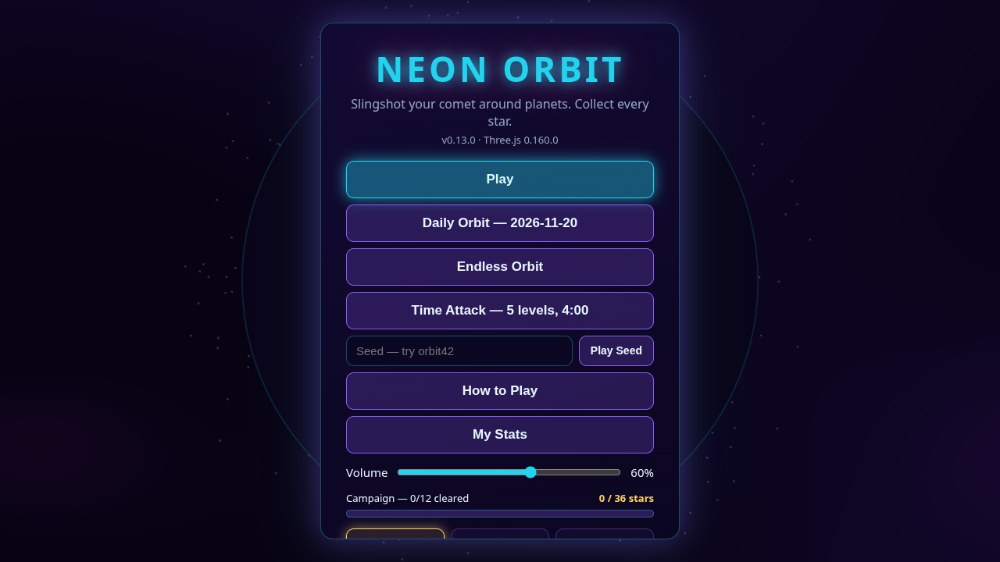
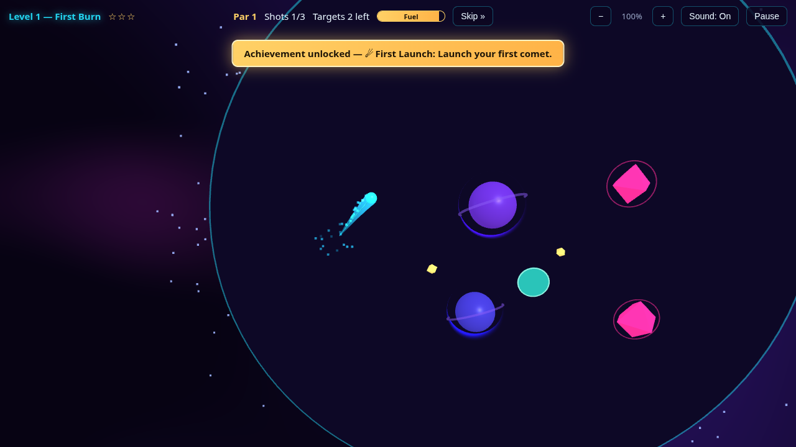

# Neon Orbit

A 3D gravity-slingshot puzzle game. Drag back from the comet to aim, release
to launch, and let the planets bend your flight. Collect every magenta star
target before you run out of shots — crash into a planet or fly out of bounds
and the shot is lost. Beat par for 3 stars and unlock the next level.

**Live:** https://namdev-muse.github.io/neon-orbit/
**Version:** v0.13.0

## Gameplay

Real captures from a headless-Chromium run of the live game
(`npm run screenshots` regenerates them — see `tests/screenshots.js`).

| Main menu | Mid-flight | Level complete |
| --- | --- | --- |
|  |  |  |

## How to play

- **Drag** back from the comet and **release** to launch — like a slingshot.
  The trajectory preview shows fading gold dots plus a pulsing end marker
  coloured by the predicted outcome (gold = target hit, red = planet crash,
  cyan = flies out), and the readout states the prediction. A quick
  **tap / click** launches with the current aim instead of re-aiming.
- Hold **Shift** while aiming for fine adjustments (quarter-size steps, also
  with the arrow keys). The HUD power meter shows launch power live.
- **Zoom:** the mouse wheel, a two-finger pinch, the HUD − / + buttons, or
  the + / − keys zoom the camera (0.6×–2×, persisted). The zoom never
  moves a collider — only the camera distance changes.
- Planets **bend** your flight with gravity. Use the bend, don't fight it.
- **Black holes** pull much harder and **swallow** any comet that crosses
  their event horizon — arc around them, never through them. A straight shot
  at one is lost.
- **Moving planets** orbit a centre point (the faint ring shows the path).
  The trajectory preview follows them live, so time your launch for when
  the bend lines up.
- **Moving targets** drift on small orbits (the faint ring shows the path).
  The trajectory preview follows them live, so lead your shot — the comet
  has to meet the target where it is, not where it was.
- **Portals** come in matching pairs (cyan, gold, or violet) — fly into
  one and you exit its twin at the same speed, with a 0.6s cooldown so
  you can't hop straight back. **Shielded targets** (white ring) take
  two hits: the first cracks the shield, the second collects the star —
  the crack persists across shots in the same attempt. **Bounce pads**
  (lime) reflect the comet like a mirror, once per pad per shot.
- Collect **every magenta target** before you run out of shots. Each
  collect fires a magenta shockwave ring and a particle burst; a win
  fires gold rings at every target.
- Skim close past a planet — inside 2 units of its surface without
  touching it — for a **slingshot** flash: a gold burst and a rising
  sweep. Crashing instead freezes the frame for a beat (hit-stop) and
  shakes the camera hard.
- Beat par for **3 stars** (par+1 = 2 stars, within budget = 1 star).
  Finishing a level unlocks the next one. Each level card and the HUD show
  the par and the exact star thresholds. The menu's campaign map tracks
  the whole run — a progress bar (levels cleared, stars out of 36) and a
  gold **NEXT** ring on the next uncompleted level. **My Stats** lists
  your best stars per level plus your daily best, endless run record,
  time attack best, and how many shared seeds you've played. Running out
  of shots shows the attempt stats (shots used vs budget, par, banked best) with Retry,
  Level Select, and Main Menu.

## Daily, seeds & Endless

- **Daily Orbit** is one fresh puzzle every day — the seed is the calendar
  date, so everyone plays the same level and the menu shows your best
  stars on it. Difficulty rotates 2–4 by day of year.
- **Seeds:** type a seed in the menu (a number like `777` or a word like
  `orbit42`) or open a `?seed=` link to replay the exact same generated
  level as a friend. Your best stars per seed are saved.
- **Endless Orbit** deals a new generated level every round, one difficulty
  step harder each time, until you run out of shots. Retry replays the
  same round; finishing a round advances to the next.
- **Time Attack** clears campaign levels 1–5 against one shared 4:00 clock.
  Clearing a level banks its stars and advances; the run ends when the
  clock hits zero, a level runs out of shots, or all five are cleared.
  Your best full clear (most stars, then fastest) is saved, and the
  music turns tense under 30 seconds.
- Every generated level is verified solvable by the same auto-aim solver
  the bot harness uses before it is offered — a challenge mode never has
  an impossible level. Par comes from the solver's shot count.

## Levels

| # | Name | Planets | Targets | Par |
|---|------|---------|---------|-----|
| 1 | First Light | 1 | 1 | 2 |
| 2 | Curveball | 1 | 1 | 2 |
| 3 | Twin Suns | 2 | 2 | 3 |
| 4 | The Long Way | 1 | 1 | 2 |
| 5 | Heavyweight | 1 | 2 | 3 |
| 6 | Gauntlet | 3 | 3 small | 3 |
| 7 | Event Horizon | 1 + 1 black hole | 1 | 2 |
| 8 | Carousel | 1 moving | 2 | 3 |
| 9 | Portal Hop | 1 + 1 portal pair | 2 | 3 |
| 10 | Shielded Stars | 2 | 2 shielded | 4 |
| 11 | Bounce House | 1 + 1 bounce pad | 2 | 3 |
| 12 | Moving Stars | 1 | 2 moving | 2 |

Pars are tuned to the auto-aim solver: par is the solver's minimal shot
count + 1 slack shot (minimum 2), except Shielded Stars, whose par 4 is
its designed minimum (two hits per shielded target). Gauntlet's targets
were spread out and shrunk in v0.10.0 after a single slow lob collected
all three.

## Controls

- Mouse / touch: drag to aim, release to launch · tap / click to launch
  with the current aim · pinch to zoom, mouse wheel to zoom
- Hold Shift while aiming for fine adjustments
- Arrow keys: adjust angle and power (Shift = fine) · Space or Enter: launch
- Enter confirms on menus (Play, Next, Retry, Resume) · arrow keys move
  between level buttons · Esc closes How to Play / My Stats
- R: retry level · P: pause · M: mute · + / −: zoom

## Tech

- Three.js **0.160.0**, pinned via import map from jsdelivr — no build step.
- Physics is pure logic in `physics.js` (fixed 1/120s substeps, inverse-square
  gravity with softening, bounding-circle collisions), shared by the game,
  the trajectory preview, and the Node test harness. Black holes use the
  same gravity law with a much larger mu and an event-horizon swallow
  radius; planets with an `orbit` travel a circle around a centre point on
  the level clock, and the preview / flight / visuals all read that clock.
  Targets with an `orbit` drift the same way — the collect check reads
  their position at the level time, so a shot must meet the target where
  it is. The solver searches launch times on moving levels, so it plans
  timed launches.
  Portals teleport the comet between twins (velocity preserved, 0.6s pair
  cooldown), bounce pads reflect velocity about the radial normal once per
  pad per shot, and shielded targets track remaining hits in the flight
  state so a crack persists across shots — the solver scores cracks so it
  plans crack-then-collect lines.
- One antialiased renderer (pixel ratio capped at 2), one PerspectiveCamera
  on a separate rig so screen shake never moves colliders.
- Pooled particles, trauma-based screen shake with hit-stop, Web Audio synth
  SFX and layered music. Every feedback event is pinned to a tier
  in `physics.js` (`FEEDBACK`): small events 0.10–0.20 trauma with no
  stop, medium 0.30–0.50 with a 0.04–0.06s stop, large 0.70–1.00 with a
  0.10–0.15s stop — and only the newest hit-stop owns the restore, so
  overlapping hits never end a freeze early. Shockwave rings are pooled
  (8 slots, reused round-robin) and expand with an ease-out before fading.
- The SFX set covers every event: launch whoosh, collect chime, crash
  thud, slingshot sweep, win arpeggio, fail jingle, unlock chime, and a
  two-tone warning when the next shot is the last one. The music loop
  layers up with intensity — calm bass on levels 1–2, an arpeggio from
  level 3, and a driving tension pulse on the last shot — and the root
  progression rotates per level. SFX and music run on separate buses
  under one master gain; the volume slider (menu + pause menu) and the
  mute toggle persist in `nor-settings`.
- Seeded levels: `generateLevel(seed, difficulty, id)` in `physics.js`
  builds a deterministic layout (planets on the pad → target corridor,
  optional black hole at difficulty 3+, optional moving planet at 2+)
  and verifies it with the shared `solveLevel` grid-search solver before
  offering it; par comes from the solver's shot count. Daily uses the
  calendar date as the seed, `?seed=` hashes a word or passes a number
  through, Endless escalates one difficulty step per round. Generated
  levels register under ids 900–902 and never touch the campaign unlock
  chain; daily and per-seed bests persist in the save.
- Best stars per level and settings persist in localStorage (`nor-stars`,
  `nor-settings`). The save also records the endless run record
  (`endlessBest`: most rounds cleared in one run) and the time attack
  best (`timeAttackBest`: stars and seconds of the best full clear of
  levels 1–5). The camera zoom
  persists in `nor-settings` too, and every overlay focuses its primary
  button so the whole game is playable from the keyboard alone.

## Run locally

```sh
python3 -m http.server 8123
# open http://localhost:8123/
```

## Run tests

```sh
npm test            # smoke tests + bot harness
node tests/smoke.js # physics / levels / save round-trip (357 checks)
node tests/bot.js   # auto-aim solver plays all 12 levels + 3 generated
                    # challenge levels to completion, plus the 5-level
                    # Time Attack set
node tests/render-check.js  # headless Chromium: menu renders, a run starts,
                            # a launch moves the comet, zero console errors;
                            # tap-to-launch, keyboard-only play, camera zoom
                            # and the 390x844 phone viewport are covered too
```

## License

MIT — see [LICENSE](LICENSE).
