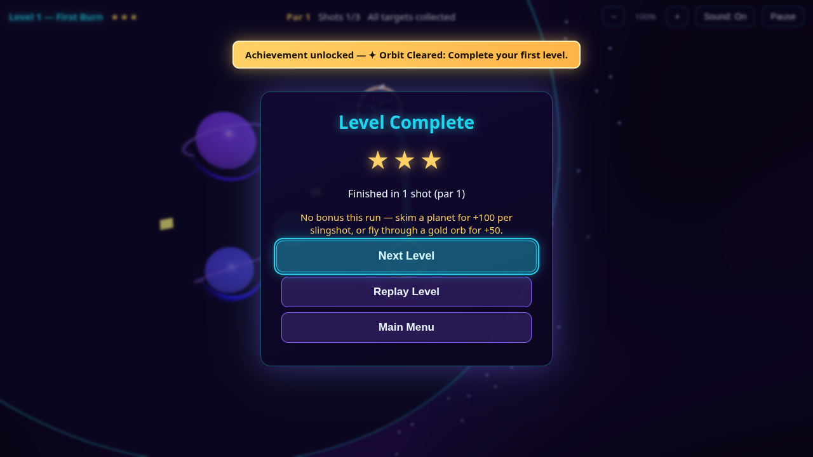

# Neon Orbit

A 3D gravity-slingshot puzzle game — **rebuilt from scratch as v2.0.0**.
Aim, launch — then **steer your comet mid-flight with limited-fuel
thrust**. Gravity bends your path; thrust lets you correct it, orbit a
planet, and thread gaps. The flight IS the game — aiming is just the
setup. Collect every magenta star target before you run out of shots —
crash into a planet or fly out of bounds and the shot is lost. Beat par
for 3 stars and unlock the next level.

**Live:** https://namdev-muse.github.io/neon-orbit/
**Version:** v2.1.0

## Why v2?

The v0.x game was a tech demo with a hollow core: Level 1 was one planet
and one target on a giant empty disc, the loop was "aim once and watch",
and the bot cleared every level in 1–2 shots. A playtest audit scored it
5/10 — the worst offender was a prediction oracle that told the player
"target hit" before they released, turning every shot into a binary
search. v2 kills the oracle, makes flying the skill, and hand-crafts
dense levels where every shot needs a real decision. No level is
clearable in par by aiming alone — the bot must fly with thrust, and
ballistics alone fail the gate on all six levels.

## Gameplay

Real captures from a headless-Chromium run of the live game
(`npm run screenshots` regenerates them — see `tests/screenshots.js`).

| Main menu | Mid-flight | Level complete |
| --- | --- | --- |
|  |  |  |

## How to play

- **Drag** from the comet to aim — the drag sets the **angle** only.
  Set the **power** with the slider or the arrow keys, then **release**
  to launch (or press the **Launch** button, or **Space**). A plain click
  never launches — every shot is a decision.
- The preview shows only the **first second** of flight. There is no
  prediction — judge the shot yourself, then fly it.
- Mid-flight, **hold** the mouse / finger to burn **thrust** toward it,
  or hold **WASD / arrow keys** to steer. Thrust burns **fuel** — the
  gold bar in the HUD. Fly through **gold orbs** to refill fuel and bank
  **+50 bonus** each. **Teal boost pads** refill **+50 fuel** and kick
  you faster along your flight — the fast line always runs close to
  something dangerous.
- **Ship upgrades** unlock with campaign stars — **Ion Thrusters**
  (+25% thrust power) at 15 stars, **Big Tank** (+30% fuel) at 30 stars.
  Toggle them in Level Select; equipped upgrades show in the HUD and fly
  on every shot. (Big Tank needs 30 stars, so it unlocks once the
  campaign grows past 6 levels.)
- Planets **bend** your flight with gravity. Use the bend, don't fight
  it. Skim close past a planet for a **slingshot** flash — time briefly
  slows so you can watch the bend — each slingshot pays a **+100
  gravity-assist bonus**.
- Collect **every magenta target** before you run out of shots. Chain
  two stars on one flight with a good burn — par rewards flying, not
  just aiming.
- Crashing into a planet or flying out of bounds **loses the shot**.
  **Black holes** pull hard and **swallow** comets — arc around them,
  never through them.
- **Moving planets** orbit their centre (the faint ring shows the path).
  Time your launch for when the bend lines up, then burn to chase the
  stars as the bend moves.
- **Portals** come in matching pairs — fly into one and you exit its
  twin at the same speed. **Shielded targets** (white ring) take two
  hits: the first cracks the shield, the second collects the star.
- Press **Space** mid-flight (or the **Skip** button) to **fast-forward**
  a long drift.
- Beat par for **3 stars** (par+1 = 2 stars, within budget = 1 star).
  Finishing a level unlocks the next one. The menu's campaign map tracks
  the whole run — a progress bar (levels cleared, stars out of 18) and a
  gold **NEXT** ring on the next uncompleted level. **My Stats** lists
  your best stars per level plus lifetime totals (shots launched, stars
  collected, shots lost, slingshots, wins, fails) and how many of the 11
  **achievements** you've unlocked — first launch, one-shot clears,
  portal hops, a full 18-star constellation and more, each toasted with
  a gold banner and a chime when earned. Progress (stars, unlocks,
  bests, stats, achievements) is saved in localStorage under a versioned
  schema (v3), so it survives reloads and older saves migrate forward;
  **Reset Progress** in My Stats wipes it all (two clicks to confirm).
  Running out of shots shows the attempt stats (shots used vs budget,
  par, banked best) with Retry, Level Select, and Main Menu.
- Skim close past a planet for a **slingshot** — time briefly slows to
  0.35× for 450ms so you can watch the bend (skipped under reduce
  motion).
- Every level is verified by two solvers: pure ballistics must NOT clear
  it within par (the anti-slop gate), and the thrust solver must clear
  it within par. A level that fails either side is not done.

## Levels

| # | Name | Planets | Targets | Par |
|---|------|---------|---------|-----|
| 1 | First Burn | 2 | 2 | 1 |
| 2 | Slingshot Turn | 2 | 3 | 2 |
| 3 | Twin Gates | 3 | 3 | 2 |
| 4 | Event Horizon | 3 + 1 black hole | 3 | 2 |
| 5 | Carousel | 1 moving + 1 | 3 | 2 |
| 6 | Grand Tour | 4 + 1 black hole + 1 portal pair | 4 (1 shielded) | 2 |

Every level has its own identity — distinct palette, layout and
mechanics. Pars are the thrust solver's shot count: the bot must FLY to
clear a level in par, never just aim. Ballistics alone need 2–3 shots on
every level, so a human can still complete any level by aiming well —
but 3 stars demand real flying.

## Controls

- Mouse / touch: drag to aim (angle), release to launch · hold mid-flight
  to steer with thrust · pinch to zoom, mouse wheel to zoom
- Power slider · arrow keys: angle (0.1° steps) and power · hold Shift
  for fine aim
- WASD / arrows mid-flight: steer with thrust · Space mid-flight:
  fast-forward · Space while aiming: launch
- Enter confirms on menus (Play, Next, Retry, Resume) · arrow keys move
  between level buttons · Esc closes How to Play / My Stats
- R: retry level · P: pause · M: mute · + / −: zoom

## Modes (dormant in v2 Block 1)

Daily Orbit, Endless Orbit, Time Attack and Zen Sandbox exist in the
physics and the bot harness, but their menu buttons are gone until their
blocks rebuild them for thrust — no dead buttons on screen. `?seed=`
links still open the exact generated level.

## Tech

- Three.js **0.160.0**, pinned via import map from jsdelivr — no build step.
- Physics is pure logic in `physics.js` (fixed 1/120s substeps, inverse-square
  gravity with softening, bounding-circle collisions), shared by the game,
  the trajectory preview, and the Node test harness. Mid-flight thrust is
  a fuel-limited acceleration (100 fuel, 32/s burn, 15 accel, +40 per
  orb) applied per substep; the thrust solver is a greedy pursuit policy
  (cruise speed 9, burn only when the velocity error exceeds 1.0) that
  re-targets after every collect. Black holes use the same gravity law
  with a much larger mu and an event-horizon swallow radius; planets with
  an `orbit` travel a circle around a centre point on the level clock,
  and the preview / flight / visuals all read that clock. Targets with
  an `orbit` drift the same way — the collect check reads their position
  at the level time, so a shot must meet the target where it is. The
  solvers search launch times on moving levels, so they plan timed launches.
  Portals teleport the comet between twins (velocity preserved, 0.6s pair
  cooldown), and shielded targets track remaining hits in the flight
  state so a crack persists across shots — the thrust solver plans
  crack-then-collect lines.
- The camera follows the comet in flight (depth + parallax), frames the
  whole field while aiming, and slow-orbits the attract scene behind the
  menu — a demo comet circling a planet over a volumetric nebula, so the
  menu IS the game, never a flat panel over darkness. One antialiased
  renderer (pixel ratio capped at 2), one PerspectiveCamera on a separate
  rig so screen shake never moves colliders. Menu flow is a screen stack
  (push/pop), one focused control per screen, focus style distinct from
  hover, safe-area insets, and a 3-resolution size sweep
  (1280x720, 2560x1080, 1080x2340) on every UI change.
- Pooled particles, trauma-based screen shake with hit-stop, Web Audio synth
  SFX and layered music. Every feedback event is pinned to a tier
  in `physics.js` (`FEEDBACK`): small events 0.10–0.20 trauma with no
  stop, medium 0.30–0.50 with a 0.04–0.06s stop, large 0.70–1.00 with a
  0.10–0.15s stop — and only the newest hit-stop owns the restore, so
  overlapping hits never end a freeze early. Shockwave rings are pooled
  (8 slots, reused round-robin) and expand with an ease-out before fading.
- The SFX set covers every event: launch whoosh, thrust burn, collect
  chime, crash thud, slingshot sweep, win arpeggio, fail jingle, unlock
  chime, and a two-tone warning when the next shot is the last one. The
  music loop layers up with intensity — calm bass on levels 1–2, an
  arpeggio from level 3, and a driving tension pulse on the last shot —
  and the root progression rotates per level. SFX and music run on
  separate buses under one master gain; the volume slider (menu + pause
  menu) and the mute toggle persist in `nor2-settings`.
- Seeded levels: `generateLevel(seed, difficulty, id)` in `physics.js`
  builds a deterministic layout (planets on the pad → target corridor,
  optional black hole at difficulty 3+, optional moving planet at 2+)
  and verifies it with the shared solver before offering it; par comes
  from the solver's shot count. Daily uses the calendar date as the seed,
  `?seed=` hashes a word or passes a number through, Endless escalates
  one difficulty step per round. Generated levels register under ids
  900–902 and never touch the campaign unlock chain; daily and per-seed
  bests persist in the save.
- Best stars per level and settings persist in localStorage (`nor2-stars`,
  `nor2-settings`, schema v4 — Block 2 adds the equipped ship upgrades).
  The camera zoom persists in `nor2-settings` too, and every overlay
  focuses its primary button so the whole game is playable from the
  keyboard alone.

## Run locally

```sh
python3 -m http.server 8123
# open http://localhost:8123/
```

## Run tests

```sh
npm test            # smoke tests + bot harness
node tests/smoke.js # physics / levels / save round-trip (484 checks)
node tests/bot.js   # thrust solver plays all 6 levels in par (3 stars),
                    # anti-slop gate (ballistics fail par on all 6),
                    # plus 4 generated levels and the Time Attack set
node tests/render-check.js  # headless Chromium: menu renders over the live
                            # 3D scene, tap never launches, drag aims,
                            # thrust steers and completes level 1, L4 graze
                            # line, zero console errors
node tests/screenshots.js  # README captures + 3-resolution size sweep
```

## License

MIT — see [LICENSE](LICENSE).
